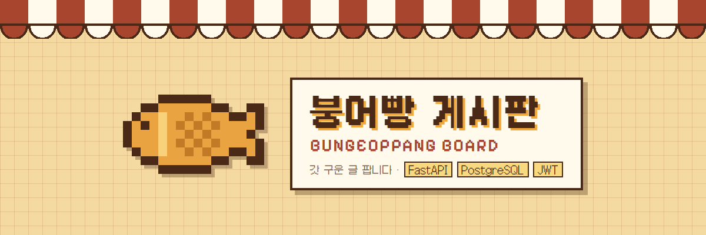
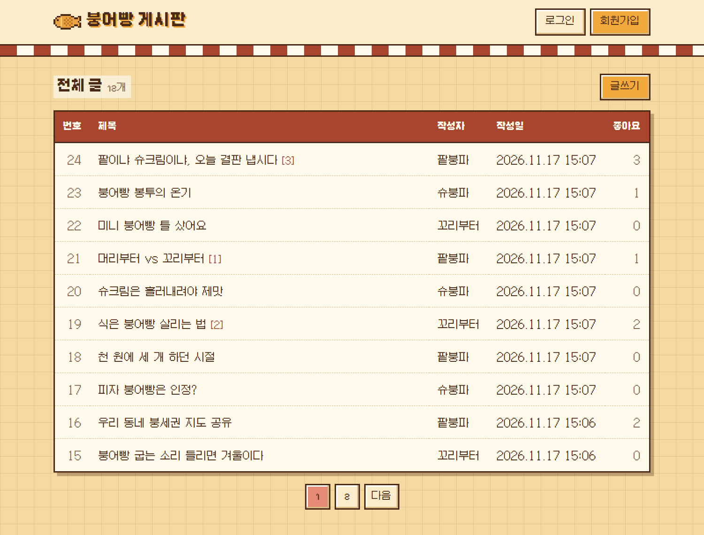
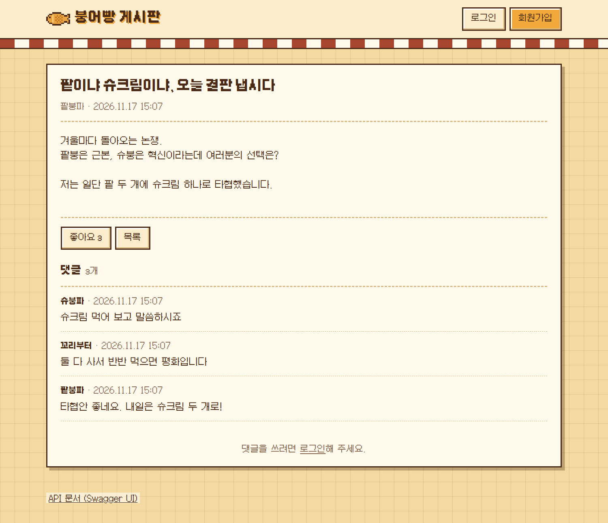
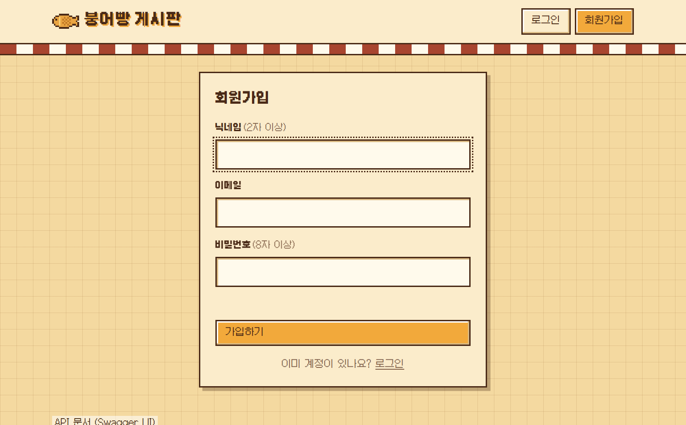

# 🐟 붕어빵 게시판 · Bungeoppang Board

[한국어](#한국어) | [English](#english)

---

## 한국어

갓 구운 글을 파는 픽셀 붕어빵가게. 글을 굽고, 좋아요를 누르고, 댓글로 수다를 떱니다.

### 가게 구경
| 글 목록 | 글 보기와 댓글 | 회원가입 |
|---|---|---|
|  |  |  |

### 재료
FastAPI · SQLAlchemy · PostgreSQL · JWT · Docker

### 주방 구조 (4계층)
`Router(주문) → Service(레시피) → Repository(재료 창고) → Model(DB)`

```
app/
├── routers/       # 주문 받기: auth, posts, comments
├── services/      # 레시피: 중복 체크, 작성자 검증
├── repositories/  # 재료 창고: DB 쿼리
├── models/        # User, Post, Like, Comment
├── schemas/       # 요청·응답 검증 (Pydantic)
├── core/          # 설정, DB, JWT, 예외, 사진 저장
└── static/        # 가게 화면
```

### 가게 열기
```bash
cp .env.example .env
docker compose up -d db
python -m venv .venv && .venv\Scripts\activate
pip install -r requirements.txt
uvicorn app.main:app --reload
```
- 가게: http://localhost:8000
- 메뉴판(Swagger): http://localhost:8000/docs
- 한 번에 열기: `docker compose up -d --build`

### 메뉴판
| 메서드 | 경로 | 인증 | 설명 |
|---|---|---|---|
| POST | `/auth/signup` | - | 회원가입 |
| POST | `/auth/login` | - | 로그인 (JWT 발급) |
| GET | `/auth/me` | O | 내 정보 |
| GET | `/posts` | - | 글 목록 (`page`, `size`) |
| GET | `/posts/{id}` | - | 글 보기 |
| POST | `/posts` | O | 글굽기 (글쓰기) |
| PATCH | `/posts/{id}` | 작성자 | 글 수정 |
| DELETE | `/posts/{id}` | 작성자 | 글 삭제 |
| PUT | `/posts/{id}/image` | 작성자 | 사진 올리기 (5MB 이하) |
| PUT · DELETE | `/posts/{id}/like` | O | 좋아요 · 취소 |
| GET | `/posts/{id}/comments` | - | 댓글 목록 |
| POST | `/posts/{id}/comments` | O | 댓글 쓰기 |
| DELETE | `/posts/{id}/comments/{comment_id}` | 작성자 | 댓글 삭제 |

에러는 언제나 같은 봉투에 담겨 나옵니다: `{"error": {"code", "message", "details"}}`

---

## English

A pixel bungeoppang (fish-shaped pastry) stand that sells freshly baked posts. Bake a post, like it, and chat in the comments.

### Take a look
| Post list | Post and comments | Sign up |
|---|---|---|
|  |  |  |

### Ingredients
FastAPI · SQLAlchemy · PostgreSQL · JWT · Docker

### Kitchen layout (4 layers)
`Router (orders) → Service (recipes) → Repository (pantry) → Model (DB)`

```
app/
├── routers/       # take orders: auth, posts, comments
├── services/      # recipes: duplicate checks, author checks
├── repositories/  # pantry: DB queries
├── models/        # User, Post, Like, Comment
├── schemas/       # request/response validation (Pydantic)
├── core/          # config, DB, JWT, exceptions, image storage
└── static/        # the storefront
```

### Open the stand
```bash
cp .env.example .env
docker compose up -d db
python -m venv .venv && source .venv/bin/activate   # Windows: .venv\Scripts\activate
pip install -r requirements.txt
uvicorn app.main:app --reload
```
- Storefront: http://localhost:8000
- Menu (Swagger): http://localhost:8000/docs
- All in one: `docker compose up -d --build`

### Menu
| Method | Path | Auth | What it does |
|---|---|---|---|
| POST | `/auth/signup` | - | Sign up |
| POST | `/auth/login` | - | Log in (returns a JWT) |
| GET | `/auth/me` | Yes | My profile |
| GET | `/posts` | - | List posts (`page`, `size`) |
| GET | `/posts/{id}` | - | Read a post |
| POST | `/posts` | Yes | Write a post |
| PATCH | `/posts/{id}` | Author | Edit a post |
| DELETE | `/posts/{id}` | Author | Delete a post |
| PUT | `/posts/{id}/image` | Author | Upload a picture (5MB max) |
| PUT · DELETE | `/posts/{id}/like` | Yes | Like · unlike |
| GET | `/posts/{id}/comments` | - | List comments |
| POST | `/posts/{id}/comments` | Yes | Write a comment |
| DELETE | `/posts/{id}/comments/{comment_id}` | Author | Delete a comment |

Errors always come in the same bag: `{"error": {"code", "message", "details"}}`
